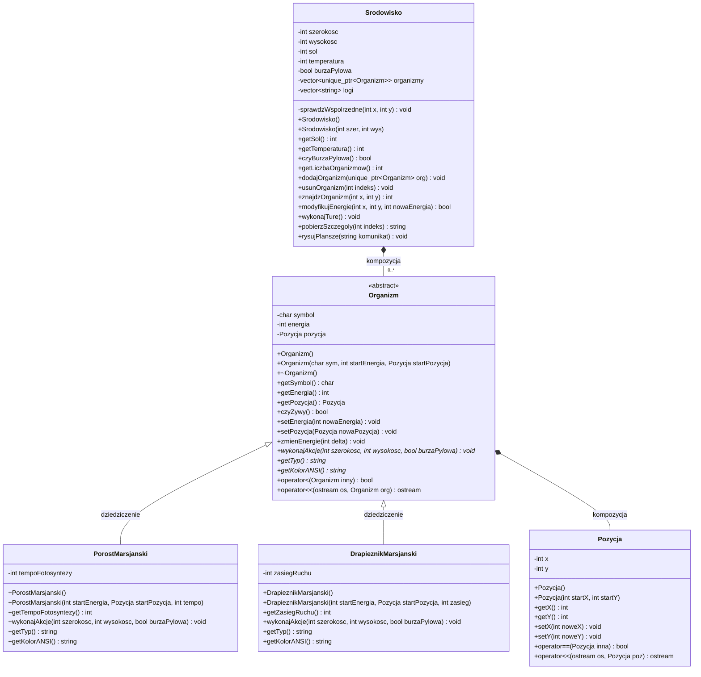

# Symulator Ekosystemu Marsjańskiego (Sektor Krateru Jezero)

Konsolowa aplikacja w języku C++ (C++17) symulująca prosty ekosystem na powierzchni Marsa, zrealizowana w ramach projektu zaliczeniowego z podstaw programowania obiektowego.

## Architektura projektu

Projekt został podzielony na pliki nagłówkowe (`.h`) i implementacyjne (`.cpp`) oraz wykorzystuje pełny zestaw mechanizmów obiektowych:

* **`Pozycja`** – reprezentuje współrzędne `(x, y)` na siatce 2D. Przeciąża operatory `==` (porównywanie pól) oraz `<<` (formatowanie współrzędnych).
* **`Organizm`** – abstrakcyjna klasa bazowa przechowująca symbol, energię i obiekt `Pozycja` (kompozycja). Definiuje metody czysto wirtualne (`wykonajAkcje`, `getTyp`, `getKolorANSI`), wirtualny destruktor oraz przeciążone operatory `<` (porównywanie energii) i `<<` (wypisywanie szczegółów organizmu).
* **`PorostMarsjanski`** – klasa pochodna dziedzicząca po `Organizm`. Nie przemieszcza się; pozyskuje energię przez fotosyntezę (spowalnianą podczas burzy pyłowej) i rozmnaża się po osiągnięciu wysokiego poziomu energii.
* **`DrapieznikMarsjanski`** – klasa pochodna dziedzicząca po `Organizm`. Przemieszcza się losowo w zadanym zasięgu, zużywa więcej energii w trakcie burzy pyłowej i pochłania napotkany porost.
* **`Srodowisko`** – zarządza planszą 2D, cyklem marsjańskich dni (Sol), temperaturą, burzami pyłowymi oraz kolekcją polimorficzną `vector<unique_ptr<Organizm>>` (kompozycja). Realizuje dodawanie, usuwanie, wyszukiwanie i modyfikację obiektów oraz kolorowe renderowanie ANSI w terminalu.

### Zastosowane mechanizmy C++
* **Enkapsulacja i `const`:** wszystkie pola są prywatne (`private`), udostępniane przez gettery i settery, a metody niezmieniające stanu obiektu oznaczono jako `const`.
* **Polimorfizm:** `Srodowisko` wywołuje w pętli wirtualne metody `wykonajAkcje()`, `getTyp()` i `getKolorANSI()` przez wskaźniki na klasę bazową `Organizm`.
* **Przeciążanie operatorów:**
  * `Pozycja::operator==` – wyszukiwanie organizmów i wykrywanie kolizji drapieżnika z porostem.
  * `Organizm::operator<` – wyznaczanie dominującego (najsilniejszego) organizmu na planszy.
  * `operator<<` (`Pozycja`, `Organizm`) – bezpośrednie wypisywanie lidera w interfejsie oraz raportów skanera.
* **Obsługa wyjątków (`try`, `catch`, `throw`):** walidacja wyjścia poza granice mapy (`out_of_range`), niepoprawnej energii, błędnego zasięgu ruchu i nieprawidłowych danych wejściowych (`invalid_argument`).

## Schemat klas UML



## Instrukcja kompilacji i uruchomienia

Wymagany jest kompilator wspierający standard **C++17** (np. `g++` z pakietu MinGW/WinLibs lub GCC).

### Kompilacja
```bash
g++ -std=c++17 Pozycja.cpp Organizm.cpp PorostMarsjanski.cpp DrapieznikMarsjanski.cpp Srodowisko.cpp main.cpp -o symulator
```

### Uruchomienie
* **Windows (PowerShell):**
  ```powershell
  .\symulator.exe
  ```
* **Linux / macOS:**
  ```bash
  ./symulator
  ```

## Przykłady działania programu

### 1. Główny widok symulacji (panel telemetryczny + siatka 2D)
```text
╔══════════════════════════════════════════════════════╗
║     SYMULATOR EKOSYSTEMU: SEKTOR KRATERU JEZERO      ║
╚══════════════════════════════════════════════════════╝
 SOL:   6 | TEMP: -54 C | BURZA PYLOWA
 Porost (*): 4 | Drapiezniki (X): 2
 Lider: Drapieznik Marsjanski [X] | Energia: 21 | Pozycja: (4, 3)

      0  1  2  3  4  5  6  7  8  9 10 11
   ╔═════════════════════════════════════╗
 0 ║  .  .  .  .  .  .  .  .  .  .  .  . ║
 1 ║  .  .  .  .  .  .  .  .  X  .  .  . ║
 2 ║  .  .  *  *  .  .  .  .  .  .  .  . ║
 3 ║  .  .  .  .  X  .  .  .  .  .  .  . ║
 4 ║  .  .  .  .  .  .  .  .  .  .  .  . ║
 5 ║  .  .  .  .  .  .  .  .  .  *  .  . ║
 6 ║  .  .  .  .  .  *  .  .  .  .  .  . ║
 7 ║  .  .  .  .  .  .  .  .  .  .  .  . ║
   ╚═════════════════════════════════════╝

[TELEMETRIA SOLA 6]
 > UWAGA: Nad sektorem przechodzi burza pylowa!
 > Porost rozrosl sie na pole (3, 2).
```

### 2. Skanowanie pola (wykorzystanie `operator==` i `operator<<`)
Po wybraniu opcji `5` i wpisaniu `4 3`:
```text
[STATUS] SKAN: Drapieznik Marsjanski [X] | Energia: 21 | Pozycja: (4, 3)
```

### 3. Obsługa wyjątku (próba dodania organizmu poza planszą)
Po wybraniu opcji `3` i wpisaniu `10 50 50`:
```text
[STATUS] WYJATEK ZAKRESU: Wspolrzedne (50, 50) wykraczaja poza sektor Marsa [0..11, 0..7]!
```